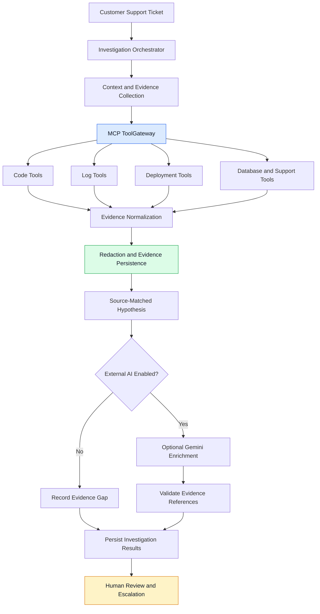
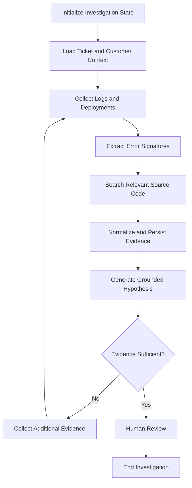
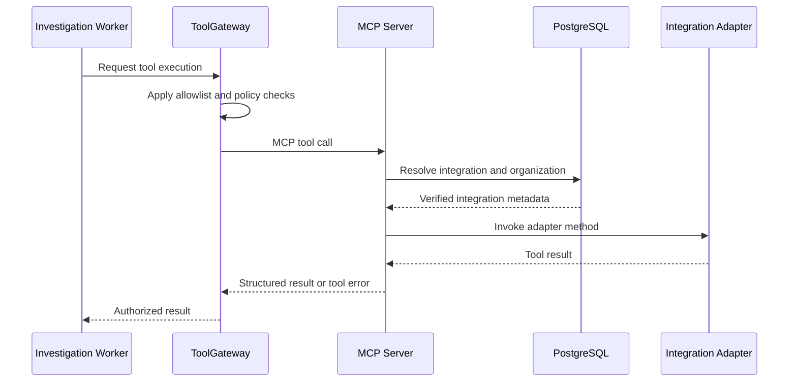

# Support2Fix — Evidence-Grounded Agentic AI for Software Support

**Support2Fix** is an AI-assisted engineering investigation platform that transforms customer support tickets into structured, evidence-backed investigations. It connects support context with application logs, deployment history, database metadata, and source code to help engineers investigate incidents systematically.

Rather than treating an LLM response as the final answer, Support2Fix prioritizes **grounded hypotheses, traceable evidence, controlled tool execution, and human oversight**.

> **Project status:** Self-hosted evidence-investigation vertical slice. Authentication, tenant isolation, ticket and customer context, integration adapters, an MCP tool server, a policy-enforcing ToolGateway, and a persistent evidence-collection worker are implemented. The complete durable LangGraph reasoning workflow, autonomous patch generation, sandboxed reproduction, approval-driven PR execution, and RAG pipeline remain planned extensions.

## Key Highlights

- **Agentic AI architecture:** Designed around a staged investigation workflow that can evolve into a LangGraph-based multi-step agent.
- **MCP tool integration:** Exposes code, logs, deployment, database and support capabilities through the Model Context Protocol.
- **Evidence-grounded diagnosis:** Collects operational evidence and searches source code using distinct error signatures extracted from logs.
- **Controlled tool execution:** Uses a ToolGateway to enforce tenant boundaries, tool allowlists and execution policies.
- **Persistent background processing:** Queues investigation jobs in PostgreSQL and processes them asynchronously.
- **Source-validated hypotheses:** Optionally enriches evidence-matched hypotheses using Gemini, validating cited evidence IDs and source locations.
- **Human-in-the-loop design:** Evidence collection concludes with escalation for human review rather than automatically declaring a root cause.
- **Privacy-conscious AI integration:** External LLM calls require explicit operator consent, with redaction and bounded evidence payloads.

## AI Architecture



*The diagram describes the current evidence-investigation flow and its intended orchestration boundary. It does not imply that the complete LangGraph reasoning workflow is already implemented.*

## Tech Stack

| Layer | Technologies |
|---|---|
| Frontend | Next.js 16, React 19, TypeScript, Tailwind CSS 4 |
| Backend | Python, FastAPI, Pydantic v2, SQLAlchemy 2 |
| Agent orchestration | LangGraph — planned complete durable reasoning graph |
| LLM integration | Gemini API, explicit opt-in external-data sharing |
| Tool interoperability | Model Context Protocol (MCP), official Python SDK |
| Data and persistence | PostgreSQL, pgvector, Alembic |
| Integrations | Local Git, application logs, deployment metadata, PostgreSQL, GitHub App |
| Infrastructure | Docker Compose, Docker, GitHub Actions |

## LangChain, LangGraph and MCP

### 1. LangGraph — State-Driven Investigation Workflows

The architecture is designed to support a graph-based investigation workflow instead of relying on a single unconstrained LLM prompt.

A future LangGraph implementation can represent investigation stages as nodes, carry evidence and execution status in shared state, and use conditional edges to determine the next step.



**Planned LangGraph capabilities:**
- Typed state shared across investigation nodes.
- Conditional routing based on evidence availability and investigation outcomes.
- Checkpointing and recovery for long-running investigations.
- Bounded retries and explicit error-handling paths.
- Human approval interrupts before consequential actions.
- Separate investigation, validation and execution stages.

The complete durable reasoning graph and its checkpoint-driven execution are not yet implemented. The current worker performs a useful subset of evidence collection.

### 2. MCP — Standardized Tool Access

Support2Fix uses the Model Context Protocol to expose integration capabilities through a consistent tool interface.

The MCP server provides **16 tools** across five namespaces:

| Namespace | Capabilities |
|---|---|
| `code.*` | Search source code, read files and inspect repository history |
| `logs.*` | Retrieve application logs and identify error signatures |
| `deploy.*` | Inspect deployment history and metadata |
| `data.*` | Inspect database metadata and perform permitted read-only queries |
| `support.*` | Access platform support tickets and customer context |

The tool server re-resolves integration records from PostgreSQL for each call, checks the organization and integration kind, and uses a service-token boundary to authenticate requests.



The MCP server standardizes tool communication; the ToolGateway provides a separate policy boundary. MCP itself does not guarantee authorization or tenant isolation.

### 3. LangChain and LLM Grounding

The optional Gemini integration enriches hypotheses using redacted ticket context and collected evidence. It remains disabled unless the operator explicitly enables external data sharing.

The grounding strategy includes:

1. Collect evidence from configured operational sources.
2. Match source-code searches against distinct error signatures or structured error codes.
3. Associate evidence with source locations and content hashes.
4. Supply a bounded, redacted evidence payload to the optional LLM.
5. Validate cited evidence IDs and source locations before displaying a hypothesis.
6. Record an evidence gap when external AI enrichment is not enabled.

**Important distinction:** Gemini enrichment is implemented as an optional integration; a complete LangChain-based retrieval and reasoning pipeline, vector-search RAG and the durable LangGraph agent are not claimed as completed features.

## Investigation Lifecycle

1. **Ticket intake:** A support engineer selects a ticket containing customer and service context.
2. **Job creation:** The API queues a persistent investigation job in PostgreSQL.
3. **Evidence collection:** The worker invokes authorized tools to collect logs, deployments and source-code evidence.
4. **Error correlation:** Distinct error signatures guide source searches without depending on a demo-specific symptom.
5. **Evidence persistence:** Results are redacted, hashed and stored with provenance.
6. **Hypothesis enrichment:** If explicitly enabled, Gemini proposes a hypothesis grounded in collected evidence.
7. **Validation:** The platform validates referenced evidence IDs and source locations.
8. **Human review:** The ticket is escalated for review; the AI does not independently confirm a root cause or create a patch.

## Security and Reliability

- **Tenant isolation:** Organization-scoped operations and composite foreign keys protect customer data boundaries.
- **Tool policy enforcement:** An allowlisted ToolGateway restricts access to permitted integration capabilities.
- **Read-only data access:** Database investigation uses a restricted PostgreSQL role and read-only transaction settings.
- **Secret isolation:** GitHub App credentials are kept outside integration configuration and are not mounted into worker or frontend containers.
- **External-data consent:** Gemini requests require an explicit opt-in flag.
- **Evidence validation:** Hypotheses must reference collected evidence and valid source locations.
- **Persistent jobs:** Investigation state is stored in PostgreSQL rather than relying solely on in-memory execution.
- **Human oversight:** Pull-request execution remains blocked unless the required approval policy is satisfied.

## Current Implementation vs. Roadmap

| Capability | Status |
|---|---|
| Authentication, RBAC and tenant isolation | Implemented |
| Ticket management and customer context | Implemented |
| Local and GitHub App integrations | Implemented |
| MCP server and 16 integration tools | Implemented |
| Policy-enforcing ToolGateway | Implemented |
| Persistent evidence-collection worker | Implemented |
| Optional Gemini hypothesis enrichment | Implemented |
| Complete durable LangGraph agent | Planned |
| Full LangChain RAG pipeline | Planned |
| Sandboxed reproduction and patch validation | Planned |
| Human-approved, approval-bound PR execution | Planned |
| Automated customer response workflow | Planned |

## Running Locally

Requirements: Docker Desktop with WSL2 on Windows, or a compatible Docker installation.

```bash
cp .env.example .env
docker compose up --build
```

Seed a local demo organization and investigation ticket:

```bash
DEMO_PASSWORD='replace-with-a-local-password' \
  docker compose run --rm -e DEMO_PASSWORD worker \
  python -m app.demo_seed
```

Open the frontend at `http://localhost:3000`, sign in with `demo@support2fix.example.com` and the password supplied to the seed command, then open the seeded checkout ticket and select **Start investigation**.

- Frontend: `http://localhost:3000`
- API documentation: `http://localhost:8000/docs`

For optional Gemini enrichment, configure `LLM_MODE=live`, `GEMINI_API_KEY`, and `LLM_ALLOW_EXTERNAL_DATA=true` in your private `.env`. Do not commit API keys or local secrets.

## Testing

```bash
cd apps/api
python -m pytest -q
python -m ruff check .
python -m ruff format --check .
python -m mypy app
```

```bash
cd apps/web
npm run test
npm run typecheck
npm run lint
npm run build
```

Database-dependent API tests require the configured test PostgreSQL database.

## Engineering Principles

- Evidence before conclusions.
- Explicit state transitions instead of unconstrained agent behavior.
- Standardized tools through MCP.
- Least-privilege integration access.
- Human approval before consequential engineering actions.
- Observable, recoverable background workflows.
- Clear separation between implemented capabilities and planned agentic extensions.

## Future Direction

Support2Fix is intended to evolve into a durable agentic engineering platform that combines LangGraph orchestration, MCP-connected tools, evidence-grounded reasoning, retrieval-augmented context, isolated reproduction, validated patch generation and human-approved pull requests.

**The objective is not merely to generate a plausible answer to a support ticket, but to make engineering investigations reproducible, auditable and safe.**
